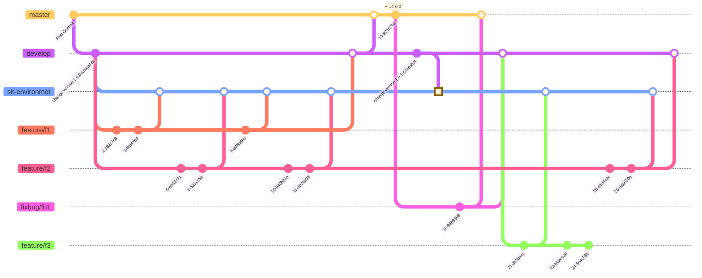

GitFlow 是一种基于 Git 的分支管理工作流模型，规定了什么时候该创建什么分支，以及分支应该合并到哪里。
- master：当前稳定的最新代码，每次develop并入产生新版本号，生产与预生产
- develop：当前稳定的最新代码，版本号snapshot，与master分支基本一致，feature的签出分支，等当前阶段开发任务的各特性分支合并到develop后，再将develop合并到master分支
- feature：特性分支
- sit-environmet：测试（开发）集成环境测试分支
- bugfix：由master签出，修复后合并master

